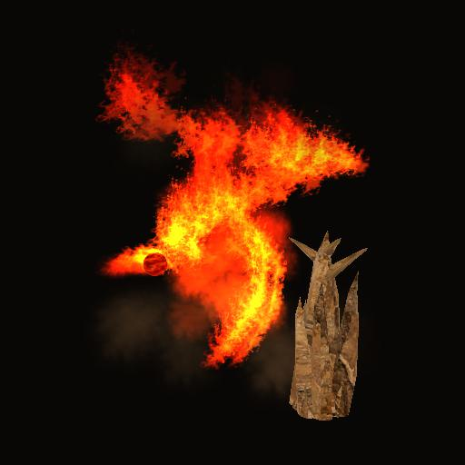

# Arcane Magic - Elemental Visuals

Steam Workshop: [Arcane Magic - Elemental Visuals](https://steamcommunity.com/sharedfiles/filedetails/?id=3832001707). The internal mod and folder name remains `Arcane Elemental Visuals`.

Version 0.1.0-beta1 — a visual add-on for Arcane Magic - Wizards of Kenshi.

Steam Workshop publication is pending. The release includes the complete mod
and corresponding source; see [Releases](https://github.com/konambu/Arcane-Elemental-Visuals/releases).
For manual installation, use the packaged release or place this repository's
contents in a directory named exactly `Arcane Elemental Visuals` under `Kenshi/mods/`.

The image is a standalone native render of the actual assets, not a game screenshot.

- Arcane Missile: red-orange fireball, flying embers, a larger backward flame and Holy-torch-style impact fire.
- Earth Spike: matte brown rock with three upper branches, about 1.5x exposed height, dust and small debris.
- Whirlwind: a spiral of fire, smoke and embers; the original visible wind mesh is hidden.

Damage, mana, attack radius, projectile speed and spell unlock conditions are unchanged.
The original Workshop files are not edited. This add-on does not write save data.

## Installation

1. Install [Arcane Magic - Wizards of Kenshi](https://steamcommunity.com/sharedfiles/filedetails/?id=3784221846).
2. Install [RE_Kenshi](https://github.com/BFrizzleFoShizzle/RE_Kenshi#installation), including its KenshiLib component.
3. Subscribe to this add-on, or extract the complete `Arcane Elemental Visuals` directory into `Kenshi/mods/` for manual installation.
4. Enable both .mod files. Load `ArcaneMagic.mod` before `Arcane Elemental Visuals.mod`.
5. Fully exit and restart Kenshi after installation or updates. Do not enable both manual and Workshop copies.

RE_Kenshi requires separate external installation. This add-on requires the
original mod. An additional save import is not needed for these visual changes;
follow the original mod's instructions when installing that mod itself.

## Compatibility and beta status

Inspected environment: Kenshi 1.0.65 x64 runtime, RE_Kenshi 0.3.5, KenshiLib 0.5.0.
Reviewed original ArcaneMagicNative.dll SHA256:
`ab19a052f418ea04ff6b3310a22ae41b11bc4f97ea96dcd51063236ee0c7c11b`.

The DLLs contain engine/build guards. Updates to Arcane Magic or the engine may
require an add-on update. Other versions and rendering overhauls are unverified.
The new v4 missile flame passed native rendering/lifecycle checks and its
appearance was confirmed by the player in Kenshi. Workshop subscription installation still needs
an end-to-end test from the downloaded numbered folder.

Known limitation: the fireball body can remain visible at the hit location.
This release preserves the accepted behavior; the rejected experimental
GPU-transform suppression is not enabled.

Publication media is a standalone render of actual resources with a simplified
render pipeline. It is not an in-game screenshot: lighting, HDR and interior
masking can differ. No standalone preview is evidence of an in-game test.

## Troubleshooting and removal

Check the game's `RE_Kenshi_log.txt` and this mod's `plugin/ElementalVisuals.log`,
`plugin/MissileEmbers.log` and `plugin/EarthStorm.log`. Logs are created at runtime.
Include runtime/original-mod versions and other rendering mods in reports.
Disable `Arcane Elemental Visuals.mod` and restart Kenshi to remove the visuals.
Keep Arcane Magic enabled if continuing a save that uses its magic system.

Complete corresponding source for both DLLs: `source/`.
Build instructions: `source/BUILD.md`. Code: GPL-3.0-only (`COPYING`).
Separate asset ownership and permissions: `CREDITS.txt`.

Special thanks to [juubi23](https://steamcommunity.com/sharedfiles/filedetails/?id=3784221846)
for creating Arcane Magic - Wizards of Kenshi and allowing others to build on
and use parts of the project. This add-on would not exist without that work.

魔法システムを制作し、派生制作・素材利用を許可してくださった原作者の
juubi23さんに感謝します。この追加MODは原作の仕組みと素材に支えられています。

日本語: Arcane Magicに依存する外見変更MODです。ミサイルを火球に、
Earth Spikeを枝分かれした岩に、Whirlwindを火の竜巻に変更します。
元MODより下に配置し、導入・更新後はゲームを完全に再起動してください。
RE_Kenshiは別途導入が必要です。威力・マナ・解放条件は変更しません。
